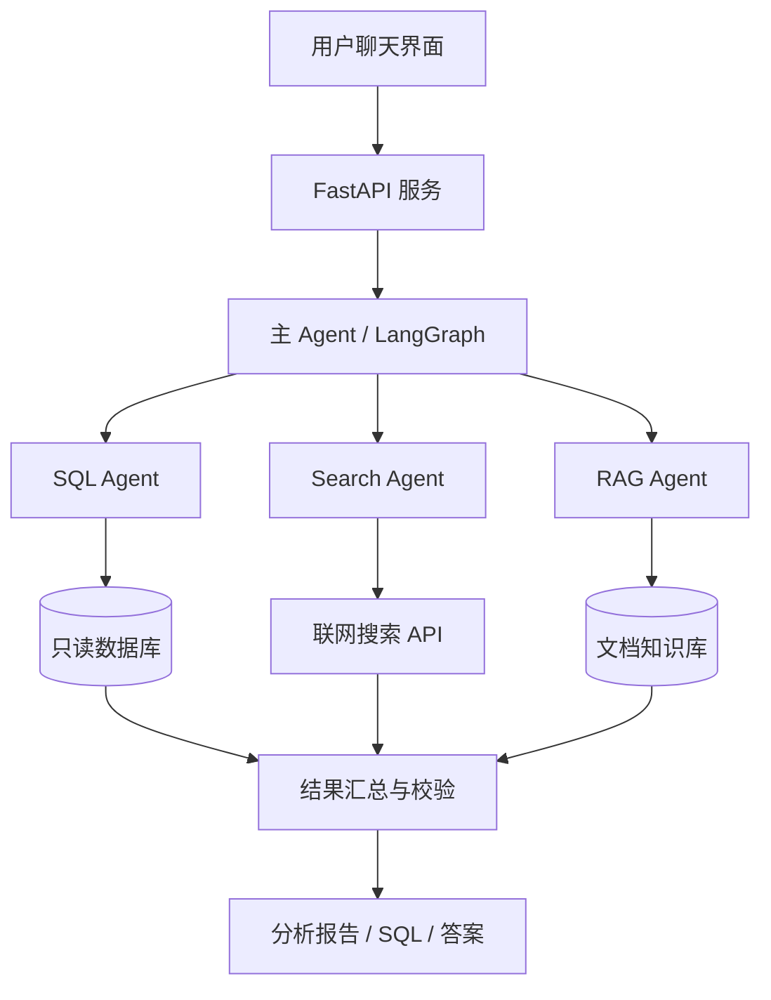

# AI 应用开发 12 周学习路线

> 学习方向：Python 后端开发、LLM 应用开发、RAG、Agent、MCP、多 Agent 协作与工程化部署  
> 建议周期：12 周（每周投入约 8–12 小时）  
> 最终成果：独立开发并部署一个支持数据库查询、联网搜索、企业知识库检索和多 Agent 协作的 AI 应用。

## 一、学习定位与目标

### 1.1 现有基础

- 已具有 Groovy 脚本开发和数据采集经验。
- 熟悉 SQL、数据库查询、ETL 数据处理和 STG → ODS → DWD → ADS 数据链路。
- 已接触采集智能体、任务自动化与数据平台流程。
- 未来希望向后端开发和 AI Agent 开发方向发展。

因此，不必从模型训练或复杂数学推导开始，优先学习**调用和构建大模型应用**，并逐步补足 Python 后端和工程化能力。

### 1.2 最终能力目标

完成学习后，希望具备以下能力：

1. 使用 Python + FastAPI 设计稳定的后端接口。
2. 调用 LLM API，实现多轮对话、流式响应、结构化输出和工具调用。
3. 建立包含文档解析、向量检索、Rerank 和引用来源的 RAG 应用。
4. 开发可调用数据库、联网搜索和文档工具的 Agent。
5. 使用 MCP 封装外部能力，理解工具集成与权限边界。
6. 使用 LangGraph 构建具有状态管理、人工审批和错误恢复的多 Agent 工作流。
7. 使用 Docker、数据库、日志、测试与评估体系部署项目。

## 二、12 周总体计划

| 周次 | 阶段 | 核心知识 | 阶段成果 |
|---|---|---|---|
| 第 1 周 | Python 基础 | Python 语法、类型注解、异常、异步基础 | Python 数据处理小工具 |
| 第 2 周 | Python 后端 | FastAPI、Pydantic、SQLAlchemy、REST API | 数据查询 API |
| 第 3 周 | LLM 基础 | Token、Prompt、上下文管理、模型 API | 简单 AI 聊天助手 |
| 第 4 周 | LLM 进阶 | Structured Output、Function Calling、Streaming | 智能 SQL 助手 V1 |
| 第 5 周 | RAG 基础 | 文档切分、Embedding、向量数据库 | 文档检索 API |
| 第 6 周 | RAG 进阶 | 混合检索、Rerank、来源引用、检索评估 | 企业知识库问答 V1 |
| 第 7 周 | Agent 基础 | 工具定义、调用循环、错误处理、Agents SDK | 数据库/联网搜索 Agent |
| 第 8 周 | MCP | MCP Client/Server、Tools、Resources、权限 | 自定义 MCP 数据工具 |
| 第 9 周 | LangGraph | State、Node、Edge、条件路由、Checkpoint | 单 Agent 工作流 |
| 第 10 周 | 多 Agent | Supervisor、Agent 分工、人工审核、结果汇总 | 多 Agent 协作 Demo |
| 第 11 周 | 工程化 | Docker、日志、鉴权、缓存、测试与 Eval | 可部署后端服务 |
| 第 12 周 | 综合实战 | 前后端集成、性能优化、README、演示 | DataAgent 完整作品 |

---

## 三、分阶段详细路线

### 第一阶段：Python + FastAPI（第 1–2 周）

**学习目标：** 熟练开发 Python Web API、连接数据库、组织规范化项目代码。

**重点：**

- Python：函数、类、类型注解、装饰器、异常处理、生成器、上下文管理器。
- Python 异步：`async` / `await`、`asyncio`、`httpx`。
- FastAPI：GET/POST、路由、请求与响应模型、依赖注入、异常处理。
- Pydantic：数据模型和字段校验。
- SQLAlchemy：数据库连接、查询、事务基础。
- 开发环境：`uv`、Git、`.env`、日志记录、项目结构。

**实践任务：** 编写一个基于 FastAPI 的数据查询后端，提供健康检查、任务列表和按条件筛选数据的接口，使用本地或脱敏示例数据库。

**验收标准：**

- [ ] 能独立运行 FastAPI 项目并打开 `/docs`。
- [ ] 能通过 API 查询本地数据库。
- [ ] 能进行基础异常处理和日志输出。
- [ ] 将项目推送至 GitHub，提供 README 和启动说明。

### 第二阶段：LLM 应用基础（第 3–4 周）

**学习目标：** 掌握模型 API 的基本使用和可靠工具调用。

**重点：**

- Token、Context Window、Temperature、模型输入输出及成本。
- System Prompt、Few-shot、上下文管理。
- LLM API、流式输出、多轮会话。
- Structured Output（结构化 JSON 响应）。
- Function Calling / Tool Calling（模型选择工具，后端执行）。
- 限流、超时、重试、错误处理以及密钥安全。

**实践项目：智能 SQL 助手 V1**

用户输入自然语言，模型从允许访问的表结构中生成 `SELECT` SQL。后端进行安全校验并使用只读账号查询，返回结果及解释。

> 重要：SQL 执行限制应由程序和数据库权限共同实现。不能只通过 Prompt 要求模型不要执行危险语句。

**验收标准：**

- [ ] 能调用至少一个 LLM API。
- [ ] 能实现流式聊天。
- [ ] 能定义并调用至少两个工具。
- [ ] SQL 助手仅允许经过验证的只读查询。

### 第三阶段：RAG 知识库（第 5–6 周）

**学习目标：** 能针对外部文档进行检索增强问答，而非完全依赖模型内置知识。

**重点：**

- 文档加载和清洗、Chunking（文本切分）。
- Embedding 和向量相似度。
- 向量数据库：先学 Chroma 或 PostgreSQL + pgvector。
- 基础 RAG：检索 → 拼接上下文 → 生成回答。
- 混合检索、Rerank、Top-K、来源引用。
- 评估：检索命中率、答案正确性、引用真实性。

**实践项目：企业文档知识库**

使用非敏感的开发规范、SQL 样例、数据字段说明构建检索问答系统。模型回答时附上引用的原始文档名称和片段。

**验收标准：**

- [ ] 能导入 Markdown、TXT、PDF 等文档。
- [ ] 能检索与问题相关的文档块。
- [ ] 回答包含可追溯来源，找不到依据时会说明不确定。
- [ ] 准备至少 20 道测试问题进行初步评估。

### 第四阶段：Agent + MCP（第 7–8 周）

**学习目标：** 让 AI 根据任务选择工具、调用外部服务、读取结果，并继续处理任务。

**重点：**

- Agent 执行循环：思考/决策、调用工具、观察结果、继续执行。
- OpenAI Agents SDK：工具注册、运行状态、异常处理和追踪。
- 为 Agent 设计三个工具：只读数据库查询、联网搜索、知识库检索。
- MCP：理解 Client、Server、Tools、Resources。
- 实现一个自己的 MCP Server，并从 Agent 端调用。
- 安全：工具最小权限、输入校验、超时、审计和人工审批。

**实践任务：** 构建一个具备自然语言查询数据库、联网检索资料和查找知识库能力的 Agent。

**验收标准：**

- [ ] Agent 能根据需求选择正确工具。
- [ ] 工具执行失败时有清晰的错误反馈。
- [ ] 自己实现并调用一个 MCP 工具。
- [ ] 工具调用有日志可追溯。

### 第五阶段：LangGraph + 多 Agent（第 9–10 周）

**学习目标：** 构建可维护、可中断、可恢复的复杂 Agent 工作流。

**重点：**

- LangGraph：State、Node、Edge、条件路由、Checkpoint。
- Agent 任务拆分与 Supervisor 协调模式。
- SQL Agent、Search Agent、Knowledge Agent 的职责边界。
- 人工确认（Human-in-the-loop）与失败恢复。
- 任务状态、上下文管理、并行与串行执行。

**实践任务：** 搭建多 Agent 协作 Demo，输入一个综合问题后由协调 Agent 分配任务，子 Agent 检索和分析，最后统一输出报告。

**验收标准：**

- [ ] 能绘制并实现清晰的工作流图。
- [ ] 多 Agent 能传递结构化结果。
- [ ] 关键操作存在人工审核节点。
- [ ] 能恢复中断任务或清楚记录失败状态。

### 第六阶段：工程化与部署（第 11–12 周）

**学习目标：** 将演示系统改造成稳定、可运行、可展示的作品。

**重点：**

- FastAPI 应用分层与配置管理。
- PostgreSQL、Redis（按需）。
- Docker / Docker Compose 和 Linux 基础。
- API 鉴权、限流、超时、重试、敏感信息保护。
- 日志、Tracing、Token 和请求成本统计。
- 单元测试、集成测试、Agent 回归评估。
- Streamlit 快速展示，或 Vue 做完整前端。

**验收标准：**

- [ ] 使用 Docker Compose 启动必要服务。
- [ ] 核心接口有自动化测试。
- [ ] 保存工具调用日志和运行指标。
- [ ] GitHub 仓库包含安装步骤、架构图和演示说明。
- [ ] 用脱敏测试数据完成一次完整项目演示。

---

## 四、建议技术栈

| 分层 | 推荐技术 | 优先级 |
|---|---|---|
| 编程语言 | Python 3.11+ | 必学 |
| Web 后端 | FastAPI、Pydantic | 必学 |
| HTTP / 异步 | httpx、asyncio | 必学 |
| 模型调用 | OpenAI SDK / 兼容模型 API | 必学 |
| Agent 基础 | OpenAI Agents SDK | 必学 |
| 图式流程编排 | LangGraph | 必学 |
| 工具协议 | MCP | 必学 |
| RAG | LangChain、Embedding | 必学 |
| 关系数据库 | PostgreSQL、SQLAlchemy | 必学 |
| 向量检索 | pgvector 或 Chroma | 推荐 |
| 缓存 | Redis | 推荐 |
| 部署 | Docker、Linux | 必学 |
| 前端展示 | Streamlit，后续可用 Vue | 按需 |

**选型原则：** 不同时学习多个同类 Agent 框架。先用原生 API 理解底层机制，再学 Agents SDK，最后使用 LangGraph 管理复杂任务。

---

## 五、毕业项目：DataAgent 智能数据开发平台

### 5.1 项目目标

开发一个融合自然语言 SQL、实时联网搜索、RAG 知识库和多 Agent 协作的全栈 AI 应用。

### 5.2 系统架构



### 5.3 核心功能

1. **智能 SQL 查询：** 自然语言转受控 SQL，查询数据后解释结果。
2. **实时联网搜索：** 查询公开的技术文档和更新资料。
3. **企业知识问答：** 根据内部规范或示例文档回答，并提供来源引用。
4. **Agent 自动调度：** 根据用户意图选择一个或多个工具。
5. **多 Agent 分工：** 协调、查询、检索、核验与报告生成。
6. **系统可观测性：** 展示请求耗时、工具调用、Token 消耗和错误日志。

### 5.4 实战案例

用户问题：

> 分析最近三个月数据采集任务异常的主要原因，并提出优化建议。

执行流程：

1. 主 Agent 分析意图并分解任务。
2. SQL Agent 查询模拟数据库中的采集任务和异常记录。
3. RAG Agent 查找数据开发规范与历史问题处理文档。
4. Search Agent 按需查找公开资料。
5. 汇总并校验统计结果，生成可追溯的分析报告。

**安全要求：** 使用模拟或脱敏数据；只读数据库账号；程序级 SQL 类型/表白名单/返回行数限制；生产环境操作需要权限检查与审批。

### 5.5 建议代码目录

```text
dataagent/
├── app/
│   ├── main.py
│   ├── api/
│   ├── agents/
│   ├── tools/
│   ├── rag/
│   ├── db/
│   ├── schemas/
│   └── core/
├── tests/
├── data/sample/
├── docs/
├── docker-compose.yml
├── pyproject.toml
├── .env.example
└── README.md
```

---

## 六、第一周每日执行计划

- [ ] **Day 1：** 安装 Python、uv、VS Code、Git；创建虚拟环境；完成 Hello World。
- [ ] **Day 2：** 学习函数、类、类型注解、异常处理；编写数据清洗小工具。
- [ ] **Day 3：** 学习 `asyncio` 和 `httpx`；编写异步 API 请求程序。
- [ ] **Day 4：** 创建 FastAPI 项目；实现 GET、POST 接口并在 `/docs` 测试。
- [ ] **Day 5：** 学习 SQLAlchemy；连接本地数据库并查询示例数据。
- [ ] **Day 6：** 封装任务查询 API，增加参数校验和错误处理。
- [ ] **Day 7：** 整理目录、添加 README、提交 GitHub，回顾本周问题。

**第一周验收：** 可以从零启动项目、访问 API、查询示例数据库、解释主要代码结构。

### 每周推荐节奏

- 工作日每天约 1 小时：学习关键概念 + 写一小段代码。
- 周末约 3–5 小时：完成一个可运行功能并整理笔记。
- 每周提交一次代码，每两周完成一个里程碑成果。

学习原则：**30% 理论 + 70% 实践**。出现问题时先定位、记录与复盘，而非只收集教程。

---

## 七、推荐官方学习资源

1. Python 官方教程：https://docs.python.org/3/tutorial/
2. FastAPI 官方教程：https://fastapi.tiangolo.com/tutorial/
3. OpenAI API 文档：https://developers.openai.com/api/docs/
4. OpenAI Agents SDK：https://openai.github.io/openai-agents-python/
5. LangChain Learn：https://docs.langchain.com/oss/python/learn
6. LangGraph 文档：https://docs.langchain.com/oss/python/langgraph/overview
7. MCP 官方文档：https://modelcontextprotocol.io/docs/getting-started/intro
8. LangChain Academy：https://academy.langchain.com/

> 官方文档可能更新；遇到 API 示例不一致时，以当前所用库版本的官方文档为准。

## 八、个人学习记录模板

每周复制并填写：

```markdown
### Week X 学习总结
- 本周目标：
- 已完成：
- 实现功能：
- 遇到的问题：
- 解决方法：
- GitHub 提交链接：
- 下周计划：
```

## 九、12 周总验收清单

- [ ] Python + FastAPI 后端能够独立开发。
- [ ] 熟悉 LLM API、流式响应、结构化输出和工具调用。
- [ ] 完成一个可以给出来源引用的 RAG 系统。
- [ ] 开发一个能够调用数据库和搜索工具的 Agent。
- [ ] 自己实现至少一个 MCP 工具。
- [ ] 使用 LangGraph 完成多 Agent 工作流。
- [ ] 项目具备基本鉴权、日志、错误处理和自动化测试。
- [ ] 项目完成 Docker 部署与演示。
- [ ] GitHub README 中有项目架构、功能说明和运行步骤。

---

**最终目标不是学完所有 AI 技术，而是具备独立交付一套真实、可运行、可维护 AI 应用的能力。**
